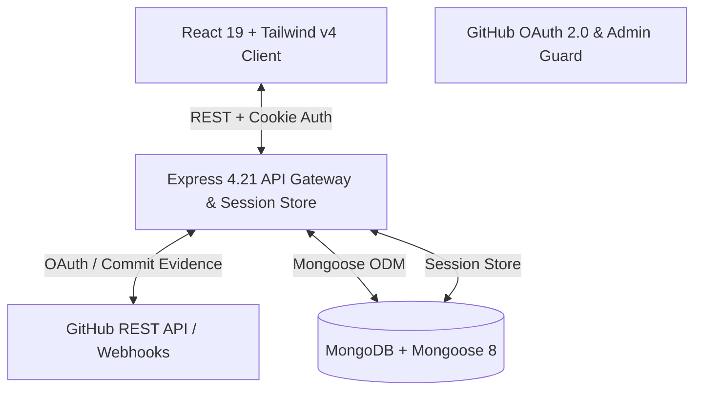

# Solvers — DSA Practice Tracker

<div align="center">


**An evidence-based DSA practice tracking platform powered by automated GitHub verification, faculty governance, and real-time student analytics.**

[](https://nodejs.org/)
[](https://react.dev/)
[](https://vitejs.dev/)
[](https://expressjs.com/)
[](https://www.mongodb.com/)
[](https://tailwindcss.com/)
[](LICENSE)

*“Consistency today, stronger tomorrow.”*

</div>

---

## 📌 Overview

**Solvers** is a full-stack, enterprise-grade Data Structures & Algorithms (DSA) accountability platform designed for academic batches and competitive coding programs. 

Unlike manual submission systems where students report solved problems on honor code, **Solvers** enforces **cryptographic and repository-level GitHub commit verification**. Every solved problem must link directly to an observed, authentic GitHub commit with matching metadata and test verification before credit is granted.

### Key Value Propositions
- **Academic Integrity by Default**: Direct GitHub OAuth integration and commit SHA verification prevent falsified submissions.
- **Faculty Governance**: Dedicated Professor & Admin Portal with enrollment approval queues, assignment distribution, and dispute resolution.
- **Dynamic Student Hub**: Real-time streak tracking, topic breakdown, peer leaderboards, and weekly activity heatmaps.
- **Zero-Friction Access Flow**: Streamlined authentication with live countdown timers on rejected/cooldown states and instant dashboard unlocking upon approval.

---

## 🏗️ System Architecture



---

## ✨ Features

### 👨‍🎓 For Students
- **Single-Click GitHub OAuth**: Onboard instantly using your GitHub account without complex password registration.
- **Live Access Status Interface**: Real-time visual tracking of enrollment approval, complete with auto-syncing status and automated cooldown countdowns (`HH:MM:SS`) if an application is declined.
- **Student Performance Dashboard**:
  - Live Streak & Consistency Calculator (derived from authentic timestamped submissions).
  - Daily Goal Tracker and Topic Progress Bars (Trees, Graphs, DP, Arrays, etc.).
  - Class Leaderboard with percentile and rank badges.
  - Assigned Problems queue with one-click code repository submission.
- **Optimized Experience**: Zero-delay instant login page, non-scrolling viewport design, and Linear/Stripe-inspired shimmer skeleton loaders.

### 👩‍🏫 For Professor Admins
- **Access Control & Approvals**: Review pending student registration requests; approve or decline with custom cooldown timers.
- **Problem & Assignment Management**: Author curated DSA problem banks with code IDs, topic classification, and target deadlines.
- **Automated Verification Pipeline**: Auto-flag suspicious submissions or failed commit SHA checks into a faculty review queue.
- **Classroom Metrics**: Real-time analytics on weekly submission velocity, active students, and overall batch performance.

---

## 🛠️ Technology Stack

| Layer | Technologies |
| :--- | :--- |
| **Frontend** | React 19, Vite 6, Tailwind CSS v4, React Router 7, Recharts, Lucide Icons |
| **Backend** | Node.js, Express.js 4.21, Helmet, Express-Session, Connect-Mongo, Zod |
| **Database** | MongoDB with Mongoose 8 ODM |
| **Auth & Verification** | GitHub OAuth 2.0 API, HMAC-SHA256 Signatures, Session Cookies |
| **Testing & Quality** | Node native test runner (`node:test`), MongoDB Memory Server, Supertest, Oxlint |

---

## 📁 Repository Structure

```
Solvers/
├── frontend/                          # React + Vite Single Page Application
│   ├── src/
│   │   ├── components/                # Reusable UI primitives, badges, modals, loaders
│   │   ├── features/
│   │   │   ├── auth/                  # LoginPage, AccessStatusPage, OAuth callbacks
│   │   │   ├── dashboard/             # StudentDashboard, AdminDashboard, Skeletons
│   │   │   ├── problems/              # Problem catalogs, assignment views
│   │   │   └── leaderboard/           # Batch rankings and streak metrics
│   │   ├── services/                  # Axios/Fetch HTTP client & network bus
│   │   └── App.jsx                    # Application routing & layout tree
│   ├── package.json
│   └── vite.config.js
│
├── backend/                           # Express REST API Server
│   ├── src/
│   │   ├── config/                    # Database connection, env loader, session config
│   │   ├── controllers/               # Auth, problems, assignments, submissions, admin
│   │   ├── middleware/                # Rate limiting, RBAC guards, session validator
│   │   ├── models/                    # Mongoose schemas (User, Problem, Submission, etc.)
│   │   └── routes/                    # API endpoints v1
│   ├── scripts/                       # Admin bootstrap and database backfill utilities
│   ├── tests/                         # End-to-end and unit test suites
│   └── package.json
│
├── DSA_Practice_Tracker_Engineering_Docs/  # Canonical Architecture, SRS, and API contracts
└── README.md                          # Project Documentation
```

---

## 🚀 Getting Started

### Prerequisites
- **Node.js**: v18.0.0 or higher
- **MongoDB**: Local instance running on `localhost:27017` or MongoDB Atlas URI
- **GitHub OAuth App**: Registered on GitHub Developer Settings with callback URL `http://localhost:5000/api/v1/auth/github/callback`

---

### 1. Backend Setup

```bash
# Navigate to backend directory
cd backend

# Create environment configuration
cp .env.example .env
```

Configure your `.env` variables:
```env
PORT=5000
MONGODB_URI=mongodb://localhost:27017/dsa_tracker
SESSION_SECRET=your_super_secret_session_key
GITHUB_CLIENT_ID=your_github_client_id
GITHUB_CLIENT_SECRET=your_github_client_secret
GITHUB_CALLBACK_URL=http://localhost:5000/api/v1/auth/github/callback
ADMIN_GITHUB_IDS=12345678,87654321
CLIENT_ORIGIN=http://localhost:5173
```

Install dependencies and start server:
```bash
# Install dependencies
npm install

# Run automated test suite (in-memory MongoDB)
npm test

# Start backend server in development mode
npm run dev
```
The backend API will be live at `http://localhost:5000`.

---

### 2. Frontend Setup

In a new terminal window:

```bash
# Navigate to frontend directory
cd frontend

# Create environment configuration
cp .env.example .env
```

Ensure `.env` points to the backend server:
```env
VITE_API_BASE_URL=http://localhost:5000
```

Install dependencies and start development server:
```bash
# Install dependencies
npm install

# Run linting check
npm run lint

# Start Vite development server
npm run dev
```
Open `http://localhost:5173` in your browser.

> **Note on Standalone Demo Mode**: If `VITE_API_BASE_URL` is omitted, the frontend automatically activates a standalone demo mode with in-memory mock personas for visual testing.

---

## 🔒 Security & Academic Integrity Model

1. **Role-Based Access Control (RBAC)**:
   - Faculty privileges are strictly hardcoded to numeric GitHub IDs specified in `ADMIN_GITHUB_IDS`. No public endpoint can elevate a user to admin status.
2. **Server-Enforced Cooldown Windows**:
   - Reapplication locks after rejection are calculated and validated strictly by server-side UTC timestamps, preventing client clock manipulation.
3. **Double Guarding**:
   - Client-side navigation guards provide user convenience, while the backend API independently authenticates and re-checks permissions on every single request.
4. **Rate Limiting & Anti-DDoS Protection**:
   - High-frequency routes (auth polling, submission verification) are guarded by route-level rate limiters to prevent API abuse.

---

## 🧪 Verification & Testing

Both frontend and backend include automated test coverage:

```bash
# Run backend test suite
cd backend
npm test

# Run frontend test suite & build validation
cd frontend
npm test
npm run lint
npm run build
```

---

## 📄 License

This project is licensed under the [MIT License](LICENSE).
